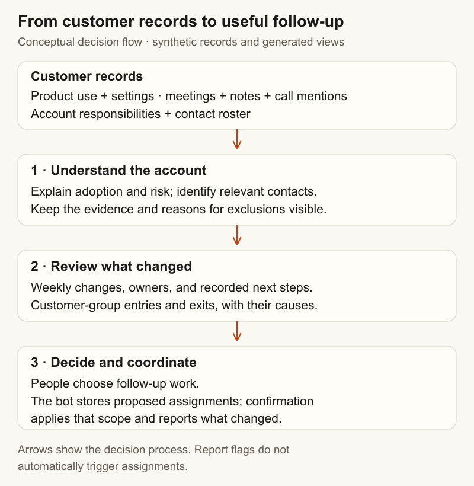
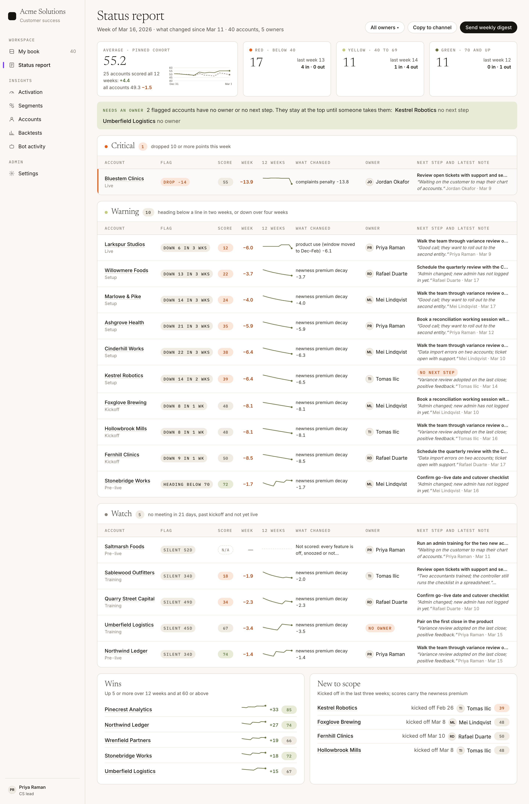

> **This is an example repo, not a library.** It exists to show one idea from an internal system, rebuilt over synthetic data so the idea can be read and run. It is not maintained as a dependency, not hardened for production, and the data in it is invented. Study the concepts; code reuse requires permission.

# Building a customer solutions platform

## Situation

A customer team needs to decide who needs help, what has changed, and who should act. Product usage shows whether customers are adopting features. Meetings and notes explain the relationship. Contact records identify the people involved. Account records say who is responsible.

Each source contributes part of that picture. A useful platform brings those records into a shared place where someone can understand an account, review their customer list, and organize the next step.

## Complication

Combining the records is not enough. A feature with no activity might be intentionally switched off. A customer can deteriorate sharply while staying inside the same yellow score band. A saved list can have the same number of accounts even though several entered and others left.

People need the evidence behind those summaries. Otherwise, they spend time investigating false alarms, miss changes hidden by familiar totals, or act on a list that no longer represents the customers they reviewed.

The challenge is to connect **what the records say, what changed, and what someone should do next**.

## Our Answer

The design connects **product use → activation score → custom segment → activation play → follow-up**, so the components help people move from understanding a customer to organizing relevant help. The platform derives explainable account signals, presents them in views designed for decisions, and records the scope of confirmed assignments. The runnable implementation uses PostgreSQL, TypeScript calculations, and generated HTML pages. Its chat commands use a small parser; no LLM connection is required.

### Make account signals explainable

Start with a recognizable question: is this customer using the parts of the product they are meant to use?

An **activation score** summarizes product adoption. Before calculating it, each feature is classified as scored or excluded, with a reason. Disabled features, temporary pauses, and features that require an unavailable integration do not enter the average. If every feature is excluded, the account is **not scored**. A feature that is enabled but has no recorded usage receives zero and says why.

For example, a customer may use reconciliations heavily while running its close checklist elsewhere. Averaging the unused checklist into its score would treat a deliberate choice as poor adoption. Recording the exclusion lets the customer team focus on actual gaps in use.

The calculation uses three selected closed months, avoiding a close still in progress. It combines feature utilization with complaint and escalation penalties and a decaying allowance for recently started customers. The stored breakdown makes those components available to the page and to weekly comparisons.

Evidence also matters when assessing relationship risk. Note keywords remain visible with their source sentence; a keyword family affects the risk calculation only after appearing under two authors on two days. That reduces the effect of one ambiguous sentence, although repetition does not establish that a statement is true. Suggested customer contacts must match the contact roster, with staff and ambiguous names removed. A frequently mentioned name alone is not evidence that someone is a customer champion.

[Activation calculation](src/activation.ts) · [Risk evidence](src/churn.ts) · [Contact candidates](src/champions.ts)

### Organize attention around change

A weekly report should help someone decide what to investigate now. Sorting every customer by its latest score leaves the reader to reconstruct what changed.

Instead, compare weekly scores and explain their movement through the stored components. A substantial drop becomes visible even when it does not cross a color boundary. Flagged accounts carry their owner and recorded next step; rows missing either appear at the top so someone can resolve the gap in responsibility.

The overall trend needs the same care. Comparing a changing population can make the average improve simply because new customers entered. A fixed cohort of accounts scored in every displayed week makes the trend a comparison of the same customers over time.

Saved customer groups need a review history too. A **custom segment** is a saved rule combining signals such as renewal timing, product adoption, and recent executive contact. Each signal distinguishes a match, a non-match, and missing coverage. This implementation conservatively marks a rule as no-data when any referenced signal lacks coverage, even if another branch matches.

Manual includes and excludes record the person, date, and reason; excludes take precedence. Comparing current member IDs with the last accepted list reveals entries and exits that an unchanged total would conceal. The review can then explain whether each change came from a signal or a recorded manual decision.

[Weekly report](src/status.ts) · [Signals and membership review](src/segments.ts)

### Connect custom segments to customer plays

The components become more useful when they work together: **product use → activation score → custom segment → activation play → follow-up**. A segment connects what the platform knows about a customer to the response that customer may need.

For example, define a segment for customers with a measured activation score below 70, using the inverse of the registered “activation 70+” signal. Link it to an **activation play**: a repeatable sequence in which an owner reviews the feature breakdown, identifies the adoption gap, offers relevant help, and checks progress later. The breakdown matters: a missing integration calls for different help from an enabled feature that nobody has started using. An unscored account needs investigation, rather than being treated as low activation.

In this design, entering a segment can trigger a play proposal or a follow-up task. Membership changes provide the point at which to act; the play defines the response and its owner. The implementation demonstrates configurable rules over registered signals, membership changes, and confirmed assignments. Connecting segment entry to play execution is an extension, not an automatic workflow currently wired into the demo.

### Carry a decision into a specific action

Once someone knows which account needs attention, they need a way to organize the work. The chat workflow can report account owner and phase or prepare assignments for an account's onboarding, cash, or owner roles.

An assignment command resolves account and staff names, stores a proposal, and shows the proposed changes. Confirmation refers to that stored proposal. In one database transaction, the handler locks its row, checks the requester and conversation, and applies the stored assignments. A changed list is refused; repeated confirmation cannot apply the proposal again. The result distinguishes new assignments from ones already present.

This closes a narrow but useful loop: the person can inspect the requested change before it becomes an assignment, and the response reports what was actually written. The generated pages illustrate that workflow; they are static views of the demo, not a connected customer-management application.

[Proposal and confirmation workflow](src/bot.ts)

## Benefits

**Spend less time preparing for customer conversations.** Product use, relationship evidence, and follow-up responsibilities sit together, so people can understand an account without piecing its story together across reports and notes.

**Focus help where it is needed.** Explained exclusions distinguish intentional product choices from adoption gaps. Visible score changes help people notice deterioration even when an account stays in the same risk band.

**Connect customer needs to repeatable help.** Custom segments provide a reusable way to select customers for activation or other plays. Reviewing membership changes keeps that selection current, while the score breakdown helps tailor the response.

**Make follow-up easier to coordinate.** Visible owners and next steps expose gaps in responsibility. Confirmed assignments preserve the requested changes and show what was applied.

[Run the example](docs/running.md) · [All six screens](docs/screens.md) · [Calculation details](docs/mechanisms.md)

Copyright © 2026 Geoffrey Lew. All rights reserved.
