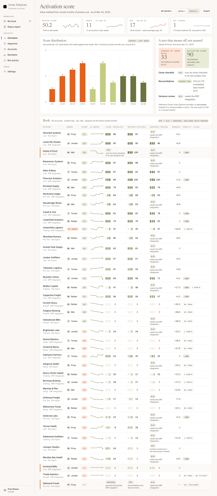
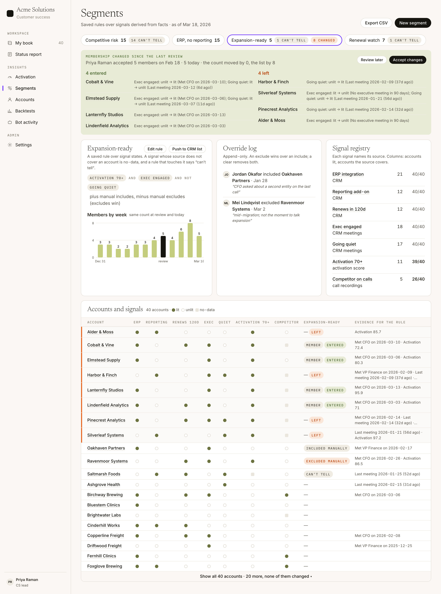
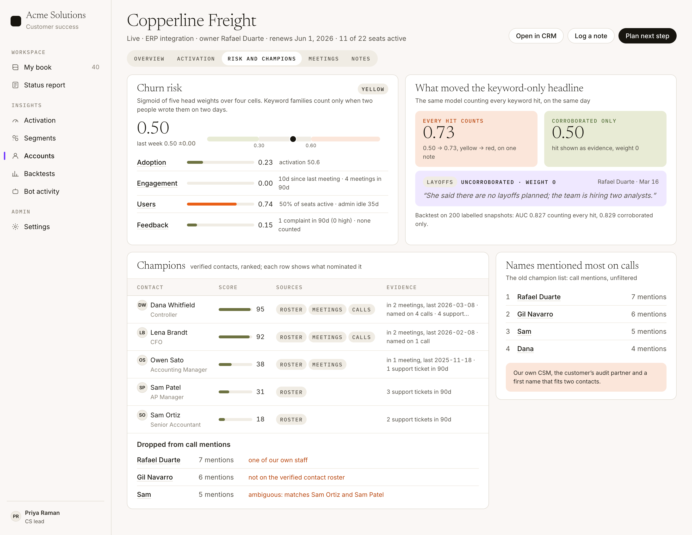
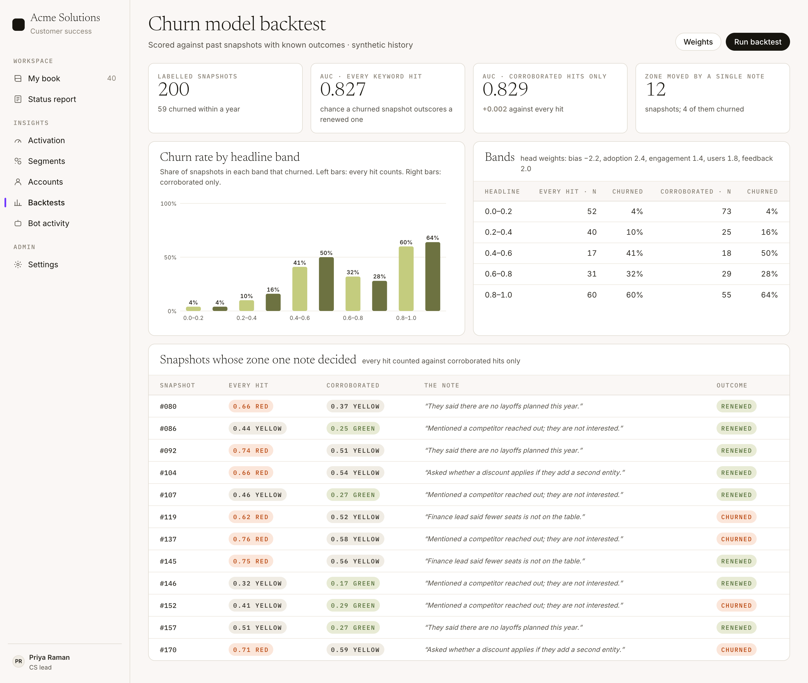
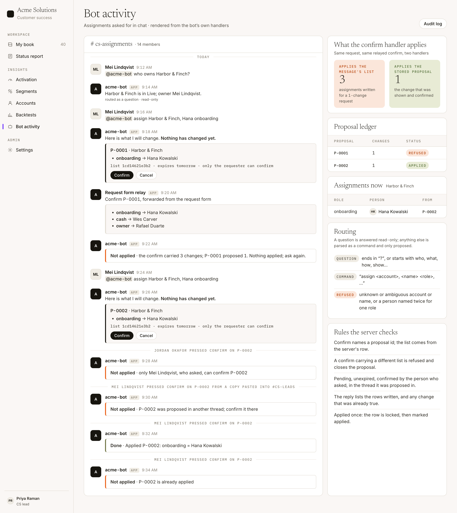

# Screens

Every page is static HTML written by `scripts/render.ts` from the seed (`pnpm render`, into
`out/`), styled by `src/ui/tokens.css`, and screenshotted at 1440 wide by `pnpm shots`. The
numbers on screen are the numbers in [`demo-output.md`](demo-output.md).

## Activation score

KPI tiles with 12-week sparklines, score distribution against last week (dashed), the Harbor &
Finch callout (33 against 90), and the whole book: one row per account, the three closed months as
squares per feature, excluded features as grey chips with their reasons.

## Status report

The pinned-cohort average against the all-accounts line, zone tiles with accounts in and out, the
needs-an-owner strip, then critical, warning and watch tables with what changed, owner, next step
and the latest note. Wins and new-to-scope at the bottom.

## Segments

Segment bar with can't-tell and changed counts, the review banner (4 entered, 4 left, causes), the
rule, members by week, the override log, the signal registry with coverage, and the accounts by
signals matrix.

## Account: churn and champions

Churn headline with its four cells and sub-signal reasons, the every-hit against corroborated
callout with the uncorroborated note, champions with sources and evidence, and the call names that
were dropped.

## Churn backtest

AUC for both rules, churn rate per headline band, and every snapshot whose zone a single note
decided, with the note and the outcome.

## Bot activity

The chat thread rendered as cards from the handlers' real results: question, proposal, refused
relayed confirm, refused confirm from the wrong person, applied confirm, refused replay. Side
cards: 3 against 1, the proposal ledger, the rules the server checks.
